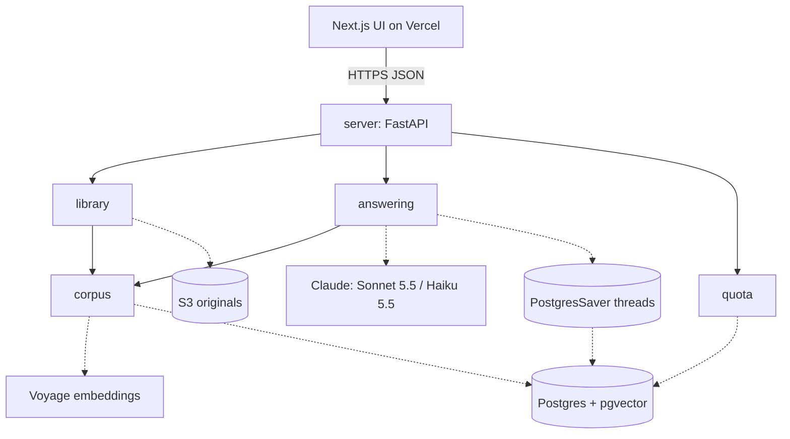
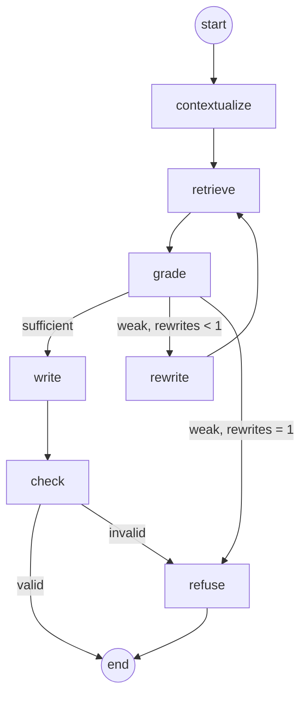

# DocQA v2: Architecture

Revised Nov 25, 2026 after grilling · supersedes "LangChain RAG Agent: Architecture Reference" (Nov 25, 2026)

## Summary

DocQA v2 rebuilds rag-doc-qa as a Python service. LangChain handles ingestion, a LangGraph graph handles answering, and FastAPI sits in front. Postgres with pgvector holds chunks, the document list, conversation threads and the daily usage counter. The API runs on Azure Container Apps and v1's Next.js UI is ported to Vercel. It lives in a new public repo, `Moe2111/rag-doc-qa-langgraph`. v1 stays live as the from-scratch version and as the baseline to beat.

**Deadline: Saturday, Nov 28, 2026.** "Done" means a live API, eval results (v2 and v1) and a README. A demo video follows after.

**What changed in grilling.** Postgres + pgvector replaces Pinecone, which removes the S3 document registry, the in-memory checkpointer, the 100-namespace cap and the one-replica limit. The v1 comparison became a must-have. The Azure 8-week rebuild plan was dropped. Its Azure work comes back later as this repo's phase 2 "Azure profile" (adapters behind the existing ports), not as a second backend. Cost controls are built for a prepaid Anthropic balance.

**Why build it.** It fixes v1's admitted limits (no conversation memory, no document deletion, one shared corpus), and it compares a from-scratch RAG app with a framework-based rebuild using the same eval set.

**The architecture in one paragraph.** Three deep modules (library, corpus, answering) each sit behind one small class, and a thin FastAPI layer calls them. Answering is a LangGraph state graph: it rewrites follow-ups, retrieves the top 4 passages, has Haiku grade them, retries once with a rewritten query, then answers with code-checked citations or refuses. Every external service sits behind a port with an in-memory adapter, so unit tests run offline. The Postgres adapter is tested against a real pgvector container in CI on every push.

## Goals, non-goals and requirements

**Goals**

- Keep v1's core promise, tested both ways: no answer without a valid citation, even when the model plainly knows the answer.
- Fix v1's limits: conversation memory, document deletion, per-visitor isolation, rate limits.
- Use LangChain and LangGraph's core pieces: documents, splitters, embeddings, state graphs, conditional edges, checkpointers, structured output, tracing.
- Prove quality with numbers: one eval set, run against v1 and v2. **This comparison cannot be cut.**

**Non-goals this sprint:** OCR, real user accounts, streaming, hybrid search, Kubernetes, fine-tuning, a UI redesign.

**Parity targets** (v1 = `rag-doc-qa@8db1204`)

| Behaviour | v1 | v2 |
| --- | --- | --- |
| Chunking | 1,500 chars, 200 overlap, fixed offsets | 1,500 / 200, paragraph and sentence boundaries |
| Embeddings | Voyage `voyage-3-lite`, 512 dims | Voyage `voyage-4-lite`, 512 dims (ADR-0004) |
| Vector store | Pinecone serverless | Postgres + pgvector, HNSW, cosine (ADR-0013) |
| Retrieval | Top 4, optional file filter | Top 4, same filter, graded, one retry |
| Answer model | `claude-sonnet-5` | `claude-sonnet-5-5` writes; `claude-haiku-5-5` contextualizes, grades, rewrites |
| Citations | File name per claim, from the prompt | Numbered markers mapped to file and page, checked in code |
| Refusal | A prompt rule | A graph route plus a code check; same fixed sentence as v1 |
| Chunk IDs | `<filename> <index>` | `(workspace_id, document_id, chunk_index)` primary key |
| Document list | None (Pinecone console) | `documents` table |
| Original files | S3 `uploads/<name>` | S3 `workspaces/<ws>/<document_id>/<name>` |
| Memory | None | Per-thread history in `PostgresSaver`, scoped to the workspace |
| Deletion | Manual | `DELETE` endpoint |
| Hosting | Next.js API routes on Vercel | Python API on Azure Container Apps; UI on Vercel |

**Functional requirements**

1. Upload a PDF, TXT or Markdown file (up to 10 MB) into a workspace; get back its document ID, chunk count and page count.
2. List the documents in a workspace, and delete one.
3. Ask a question in a workspace, optionally limited to named documents and optionally continuing a thread.
4. Every answer carries numbered citations (file, page, snippet) or is an explicit refusal.
5. A follow-up question resolves against its thread's history.

**Non-functional requirements**

- **Correctness:** refusal accuracy and citation validity measured by the eval set; targets set after the first baseline.
- **Testability:** unit tests run offline with no keys; the Postgres contract suite runs in CI against a service container, also with no keys.
- **Type safety:** pyright strict and ruff pass with zero errors.
- **Cost:** no fixed monthly cost beyond free tiers; model spend is hard-capped by a prepaid Anthropic balance (ADR-0016).
- **Security:** no secrets in the repo, upload limits, per-IP and global rate limits, workspace isolation proven by tests.
- **Observability:** every request is traced with workspace and thread IDs; logs are structured JSON.

## System overview



Dashed edges are ports: each has a real adapter and an in-memory one.

**Ingest flow** (`POST /v1/workspaces/{ws}/documents`)

1. `server` rejects oversize bodies (by `Content-Length`, before reading) and calls `Library.add`.
2. `library` checks the type by magic bytes and hashes the file. If the same name and hash already exist, it returns the existing `DocumentInfo`.
3. It loads pages (pypdf for PDF, a plain read for TXT/MD), collapses whitespace and splits into chunks.
4. It writes the original to S3 (same key per document, so a re-upload overwrites). If S3 fails, it raises and nothing else changes.
5. It calls `Corpus.put_document`, which embeds the chunks in batches, then **in one transaction** upserts the `documents` row and replaces all of that document's chunks. If this fails, the previous version stays intact in Postgres. A newer file left in S3 is harmless because originals are never served.

**Ask flow** (`POST /v1/workspaces/{ws}/ask`)

1. `server` checks the per-IP limit and the global daily cap, validates the body and calls `Answerer.ask`.
2. If a `thread_id` is given and no checkpoint exists for `{workspace}/{thread_id}`, `ask` raises `ThreadNotFound` → `404 thread_not_found`.
3. The graph runs: standalone question, search, grade, at most one rewrite, then a checked answer or a refusal.
4. `PostgresSaver` saves the turn; `server` returns the `Answer`.

## The answer graph



**State**

```python
class AnswerState(TypedDict):
    messages: Annotated[list[AnyMessage], add_messages]  # the only field that persists across turns
    workspace: WorkspaceId
    question: str
    search_query: str
    only: list[DocumentId] | None
    passages: list[Passage]
    grade: Grade | None
    rewrites: int        # reset to 0 on every invoke
    draft: str
    answer: Answer | None
```

Every invoke passes fresh values for all per-turn fields; only `messages` carries over. The thread stores the question and the final text, refusals included.

**Nodes**

| Node | What it does | Model |
| --- | --- | --- |
| `contextualize` | Turns a follow-up into a standalone question from the last 6 turns; passes through on a new thread | Haiku, effort `low` |
| `retrieve` | `Corpus.search(ws, search_query, k=4, only=only)` | None (Voyage embeds the query) |
| `grade` | One structured call for all passages → `Grade(sufficient, relevant)`. `sufficient=True` with empty `relevant` counts as insufficient | Haiku, effort `low` |
| `rewrite` | One new search query, never an answer; `rewrites += 1` | Haiku, effort `low` |
| `write` | Answers from the relevant passages only, renumbered [1]..[m]; replies `NO_ANSWER` when they don't cover it. An API `stop_reason: refusal` is treated as `NO_ANSWER` | Sonnet, effort `medium`, `max_tokens` 4,096 |
| `check` | Pure code: rejects `NO_ANSWER`, no markers, or any marker outside 1..m; builds citations with the first 200 chars of each cited passage as the display snippet | None |
| `refuse` | Returns v1's fixed refusal sentence, word for word, `refused: true` | None |

**Prompts.** The writer answers only from passages inside delimiters, treats them as untrusted data, puts `[n]` after each claim, and says exactly `NO_ANSWER` when they don't cover the question. The grader returns a `Grade` via `with_structured_output`. The rewriter returns one search query.

**Why this shape:** refusal is enforced by routing and code, so scripted-model tests prove it offline. Cost is bounded at 2 searches and 5 Claude calls per question. A phase 2 agent mode replaces `graph.py`, not its tests.

## Modules and interfaces

| Module | Owns | Public interface | Hidden inside |
| --- | --- | --- | --- |
| `library` | Turning files into documents | `Library.add`, `list`, `remove` | Validation, loaders, cleaning, splitter config, S3 originals |
| `corpus` | Documents and chunks at rest | `Corpus.put_document`, `list_documents`, `delete_document`, `search` | Embeddings, SQL, schema, Postgres vs memory adapter |
| `answering` | Question → answer or refusal | `Answerer.ask` | Graph, prompts, grading, rewrite, citation check, threads |
| `quota` | The global daily question cap | `Quota.take(day) -> bool` | Postgres counter row vs in-memory counter |
| `server` | HTTP only | `create_app(services)` | Routes, limits, error mapping, request IDs |

`corpus` owns both the `documents` and `chunks` tables so that a re-upload is one transaction (ADR-0012, ADR-0014). `library` never touches SQL.

```python
# domain.py: shared, frozen Pydantic types
WorkspaceId = NewType("WorkspaceId", str)    # UUID4 made in the browser
DocumentId = NewType("DocumentId", str)      # sha256(ws + "/" + file_name)[:16]

class Upload(BaseModel): name: str; content_type: str; data: bytes
class DocumentInfo(BaseModel): document_id: DocumentId; name: str; pages: int; chunks: int; content_hash: str; uploaded_at: datetime
class Chunk(BaseModel): index: int; text: str; page: int | None; start_index: int
class Passage(BaseModel): document_id: DocumentId; name: str; page: int | None; text: str; score: float
class AskRequest(BaseModel): workspace: WorkspaceId; question: str; thread_id: str | None = None; document_ids: list[DocumentId] | None = None
class Citation(BaseModel): n: int; document_id: DocumentId; name: str; page: int | None; snippet: str
class Answer(BaseModel): thread_id: str; text: str; refused: bool; citations: list[Citation]

class Corpus:
    def __init__(self, store: ChunkStore, embeddings: Embeddings) -> None: ...
    def put_document(self, ws: WorkspaceId, info: DocumentInfo, chunks: Sequence[Chunk]) -> None: ...  # atomic replace
    def list_documents(self, ws: WorkspaceId) -> list[DocumentInfo]: ...
    def find_document(self, ws: WorkspaceId, doc: DocumentId) -> DocumentInfo | None: ...
    def delete_document(self, ws: WorkspaceId, doc: DocumentId) -> None: ...
    def search(self, ws: WorkspaceId, query: str, *, k: int = 4, only: Sequence[DocumentId] | None = None) -> list[Passage]: ...

class Library:
    def __init__(self, corpus: Corpus, blobs: BlobStore, *, max_bytes: int = 10_000_000, max_documents: int = 20) -> None: ...
    def add(self, ws: WorkspaceId, upload: Upload) -> DocumentInfo: ...
    def list(self, ws: WorkspaceId) -> list[DocumentInfo]: ...
    def remove(self, ws: WorkspaceId, doc: DocumentId) -> None: ...   # chunks + row first, then S3

class Answerer:
    def __init__(self, corpus: Corpus, models: Models, checkpointer: BaseCheckpointSaver[str]) -> None: ...
    def ask(self, request: AskRequest) -> Answer: ...   # raises ThreadNotFound
```

**Ports and adapters**

| Port | Real adapter | Test adapter | Why a port |
| --- | --- | --- | --- |
| `ChunkStore` | Plain SQL via psycopg 3 + `pgvector` (ADR-0014) | Python dicts with cosine similarity | Transactions and workspace scoping in one place |
| `Embeddings` (LangChain) | `VoyageAIEmbeddings` | `DeterministicFakeEmbedding` | Already a LangChain interface |
| `BlobStore` | S3 via boto3 | A dict | Library tests without AWS |
| `Models` | Claude via `langchain-anthropic`; prompts live here | Scripted outputs per test | The fake chat model can't do structured output |
| Checkpointer (LangGraph) | `PostgresSaver` | `InMemorySaver` | Already a LangGraph interface |
| `QuotaStore` | One Postgres row per UTC day | A counter | Survives restarts and works across replicas |

**Dependency rules** (`import-linter` in CI): `server` imports only the public classes of `library`, `answering` and `quota`. `library` and `answering` may import `corpus`, but not each other. Only `wiring.py` imports vendor SDKs and picks adapters (`DOCQA_ADAPTERS=live|memory`).

**Repo layout**

```
rag-doc-qa-langgraph/
├── backend/
│   ├── pyproject.toml            # deps + ruff, pyright, pytest, import-linter
│   ├── Dockerfile
│   ├── src/docqa/
│   │   ├── domain.py
│   │   ├── settings.py           # pydantic-settings; the only env reader
│   │   ├── wiring.py             # build_services(settings)
│   │   ├── library/              # loading.py, splitting.py, blobs.py
│   │   ├── corpus/               # store.py (port), postgres.py, memory.py, schema.sql
│   │   ├── answering/            # graph.py, citations.py, models.py, prompts.py
│   │   ├── quota/
│   │   └── server/
│   ├── tests/                    # through public interfaces; tests/contract/ hits Postgres
│   └── evals/                    # golden.jsonl, run.py, judges.py, results/, RESULTS.md
├── frontend/                     # v1 page, ported
├── infra/bootstrap.sh
├── docs/ARCHITECTURE.md, GLOSSARY.md, adr/
├── CODING_STANDARDS.md, RUNBOOK.md
└── .github/workflows/            # ci.yml, deploy-backend.yml, evals.yml
```

## Data and API contracts

**Schema** (`corpus/schema.sql`, idempotent, applied at startup; ADR-0015)

```sql
CREATE EXTENSION IF NOT EXISTS vector;

CREATE TABLE IF NOT EXISTS documents (
  workspace_id  uuid        NOT NULL,
  document_id   text        NOT NULL,
  name          text        NOT NULL,
  pages         int         NOT NULL,
  chunks        int         NOT NULL,
  content_hash  text        NOT NULL,
  uploaded_at   timestamptz NOT NULL DEFAULT now(),
  PRIMARY KEY (workspace_id, document_id)
);

CREATE TABLE IF NOT EXISTS chunks (
  workspace_id  uuid    NOT NULL,
  document_id   text    NOT NULL,
  chunk_index   int     NOT NULL,
  page          int,
  start_index   int     NOT NULL,
  text          text    NOT NULL,
  embedding     vector(512) NOT NULL,
  PRIMARY KEY (workspace_id, document_id, chunk_index),
  FOREIGN KEY (workspace_id, document_id) REFERENCES documents ON DELETE CASCADE
);
CREATE INDEX IF NOT EXISTS chunks_embedding_hnsw ON chunks USING hnsw (embedding vector_cosine_ops);

CREATE TABLE IF NOT EXISTS daily_usage (day date PRIMARY KEY, questions int NOT NULL DEFAULT 0);
```

LangGraph's `PostgresSaver.setup()` creates its own checkpoint tables.

**Isolation (ADR-0007):** `workspace_id` leads every primary key, and every query filters on it. All SQL lives in `corpus/postgres.py` and `quota`. A contract test proves workspace B never sees A's documents or chunks.

**IDs.** `document_id` = first 16 hex chars of `sha256(workspace_id + "/" + file_name)`, so the same name in the same workspace is the same document and re-uploading replaces it. The internal thread key is `{workspace_id}/{thread_id}`, so a thread can't be reached from another workspace.

**Limits.** 10 MB per file, 20 documents per workspace (`409 workspace_full`), 1,000-character questions.

**Endpoints**

| Method and path | Request | Success | Errors |
| --- | --- | --- | --- |
| `GET /health` | none | 200 `{status, version}` | none |
| `POST /v1/workspaces/{ws}/documents` | multipart `file` | 201 `DocumentInfo` | 400, 413, 415, 422 no text, 409 workspace full, 403 sample workspace without admin key |
| `GET /v1/workspaces/{ws}/documents` | none | 200 `{documents}` | none |
| `DELETE /v1/workspaces/{ws}/documents/{document_id}` | none | 204 | 404, 403 sample workspace |
| `POST /v1/workspaces/{ws}/ask` | `{question, thread_id?, document_ids?}` | 200 `Answer` | 422, 404 `thread_not_found`, 429 `rate_limited` / `daily_limit_reached`, 502 |

`ws` must be a UUID4 (422 otherwise). On `404 thread_not_found`, the UI says the conversation expired and resends without `thread_id`.

**Errors:** `{"error": {"code", "message", "request_id"}}` everywhere; 5xx bodies carry no internal detail.

## Tech stack and configuration

| Layer | Choice | Notes |
| --- | --- | --- |
| Language / packaging | Python 3.13, uv | One lockfile for local, CI and Docker |
| Graph / core | `langgraph` 1.2.x (`<2`), `langchain-core` 1.8.x, `langchain` 1.5.x | |
| Splitting | `langchain-text-splitters` | `RecursiveCharacterTextSplitter(1500, 200, add_start_index=True)` |
| PDF | `pypdf` → LangChain `Document`s | |
| Chat models | `langchain-anthropic` | Sonnet 5.5 writer (`medium`), Haiku 5.5 small roles (`low`) |
| Embeddings | `langchain-voyageai` | `voyage-4-lite`, `output_dimension=512` |
| Database | Postgres + pgvector; `psycopg[binary,pool]`, `pgvector` | Azure Flexible Server B1MS (free offer) or Neon free (ADR-0013) |
| Threads | `langgraph-checkpoint-postgres` | `PostgresSaver` |
| File storage | boto3, v1's S3 bucket | New prefix |
| HTTP | FastAPI + uvicorn, sync handlers | |
| Rate limits | `slowapi`, keyed on the client IP from the rightmost `X-Forwarded-For` entry added by ACA ingress (verify in T5) | Plus the global daily cap |
| Gates | ruff, pyright strict, pytest, import-linter | |
| Tracing | LangSmith Developer (free) | |
| Hosting | Azure Container Apps (consumption, Germany West Central), image on GHCR | Min 0, max 2 replicas. The Students subscription only allows uaenorth, polandcentral, spaincentral, germanywestcentral and austriaeast; GWC is the closest of these to the US-hosted Anthropic and Voyage APIs |
| UI | v1's Next.js page on Vercel | |

**Environment variables** (read only by `settings.py`)

| Variable | Example | Used by |
| --- | --- | --- |
| `ANTHROPIC_API_KEY` | secret | answering |
| `VOYAGE_API_KEY` | secret | corpus |
| `DATABASE_URL` | `postgresql://…?sslmode=require` | corpus, answering (checkpointer), quota |
| `AWS_ACCESS_KEY_ID`, `AWS_SECRET_ACCESS_KEY`, `AWS_REGION`, `S3_BUCKET` | secrets | library |
| `LANGSMITH_TRACING`, `LANGSMITH_API_KEY`, `LANGSMITH_PROJECT` | `true`, secret, `docqa-v2` | tracing |
| `DOCQA_WRITER_MODEL`, `DOCQA_WRITER_EFFORT`, `DOCQA_WRITER_MAX_TOKENS` | `claude-sonnet-5-5`, `medium`, `4096` | answering |
| `DOCQA_SMALL_MODEL`, `DOCQA_SMALL_EFFORT` | `claude-haiku-5-5`, `low` | answering |
| `DOCQA_EMBEDDING_MODEL`, `DOCQA_EMBEDDING_DIM` | `voyage-4-lite`, `512` | corpus |
| `DOCQA_TOP_K`, `DOCQA_MAX_REWRITES` | `4`, `1` | answering |
| `DOCQA_DAILY_QUESTION_CAP` | `100` | quota |
| `DOCQA_SAMPLE_WORKSPACE`, `DOCQA_ADMIN_KEY` | UUID, secret | server |
| `DOCQA_CORS_ORIGINS` | Vercel URL | server |
| `DOCQA_ADAPTERS` | `live` or `memory` | wiring |
| `DOCQA_JUDGE_MODEL`, `DOCQA_JUDGE_EFFORT` | `claude-sonnet-5-5`, `low` | evals only |

## Quality: tests, evals and tracing

| Layer | Proves | Runs | Keys |
| --- | --- | --- | --- |
| ruff, pyright strict, import-linter | Types, patterns, module boundaries | Every push | No |
| Unit tests (memory adapters) | Routing, citation checks, IDs, re-upload, API contract | Every push | No |
| Contract tests (pgvector service container, fake embedder) | Postgres adapter = memory adapter; isolation; atomic replace; `PostgresSaver` threads | Every push | No |
| Evals (in-process via `build_services()`) | Quality, refusals, citations, latency, cost | Manual, and before merging prompt/model/chunking/`k` changes | Yes |
| Tracing | What happened on a real request | Always | Yes |

**Starter tests**

- **library:** a same-name re-upload replaces every old chunk even when shorter; an unchanged re-upload skips embedding; 11 MB, `.docx` and image-only PDF each fail with their own error; an S3 failure on a re-upload leaves the previous version searchable; a corpus failure after the S3 write leaves the previous version intact; `remove` deletes chunks, row and original; the 21st document gets `workspace_full`.
- **corpus (contract, both adapters):** add then search; delete then search; the document filter; workspace B never sees A.
- **answering:** good passages → cited answer; weak then good → exactly one rewrite; weak twice → refusal and the writer never runs; `[5]` with 4 passages, no markers, or `NO_ANSWER` → refusal; `sufficient` with empty `relevant` → treated as weak; a follow-up uses the previous turn; an unknown thread → `ThreadNotFound`; a thread from workspace A is invisible to B; `rewrites` resets each turn.
- **server:** each domain error maps to its code; a 500 never leaks exception text; a bad workspace ID returns 422; the daily cap returns 429 `daily_limit_reached`; writes to the sample workspace need the admin key.

**Evals**

- **Corpus** (also the read-only sample workspace): NIST Cybersecurity Framework 2.0, NIST AI RMF 1.0 (both US-government public domain), OWASP Top 10 for LLM Applications 2025 (CC BY-SA).
- **Golden set:** about 40 questions in `evals/golden.jsonl`, drafted by Claude from the documents and reviewed by you. Categories: answerable from one passage; needs two passages; unanswerable but the model knows it (e.g. ISO 27001 clauses, EU AI Act fines); unanswerable and obscure; follow-ups; questions limited to one document.
- **Metrics:** refusal precision/recall and citation accuracy (scored in code); correctness and faithfulness (pass/fail from the judge). **Faithfulness is judged against the full cited passage**, not the 200-char display snippet.
- **Judge:** `claude-sonnet-5-5` at effort `low`, configurable. Re-score the final README numbers with `claude-opus-5-5` if budget allows.
- **v1 baseline (must-have):** run `rag-doc-qa@8db1204` in a separate git worktree, pointed at its own Pinecone eval index (not the live demo's). It's scored at file level since v1 has no pages. Record the commit in `RESULTS.md`.
- **How it runs:** in-process, calling `Answerer.ask` on services from `build_services(settings)` with live adapters, not through the HTTP API. That means no daily cap, no rate limits and no cold starts, and it matches how the v1 baseline runs locally. The HTTP layer is covered by server tests and the deploy smoke test.
- **Cost:** about $0.60 per v2 run plus about $0.35 judging; v1 is similar.

**Tracing:** LangSmith with `workspace_id`, `thread_id`, `request_id` and version as run metadata. Logs are JSON lines without question text.

**CI** (`ci.yml`): `uv sync --locked` → `ruff format --check` + `ruff check` → `pyright` → `lint-imports` → `pytest` (unit + contract, with a `pgvector/pgvector` service container) → Docker build + `/health` smoke test with `DOCQA_ADAPTERS=memory` → frontend `npm ci`, lint, build.

## Security

| Threat | Control |
| --- | --- |
| Bill abuse | Prepaid Anthropic balance with auto-reload **off** (hard ceiling); global cap of 100 questions/day; per-IP limits (20 questions/min, 10 uploads/hour); upload and question size limits; writer effort `medium` with `max_tokens` 4,096 |
| Reading another visitor's documents | `workspace_id` in every key and query; SQL only in `corpus`; isolation contract test on every push; threads keyed by workspace |
| Database exposure | Public endpoint with TLS required, a strong generated password stored as a Container Apps secret, and a firewall that allows your dev IP plus the Container Apps environment's outbound IPs (fallback: "allow Azure services"). **Caveat:** "allow Azure services" admits traffic from any Azure customer's resources, not just yours, and consumption outbound IPs can change. Acceptable for a demo with no sensitive data; the real fix is phase 2's managed identity or private networking |
| Prompt injection | Delimited, untrusted passages; no tools; citation check; UI renders text, never HTML |
| Malicious uploads | Magic-byte type check; size rejected before reading; pypdf only; originals never served |
| Leaked secrets | Container Apps + GitHub secrets only; `.env` gitignored; secret scanning with push protection; OIDC deploys |
| Error leakage | 5xx bodies carry a code and request ID only |
| Supply chain | Locked deps; Dependabot |

**The limit, stated out loud:** a UUID workspace is a capability link, not authentication. The README says so.

## Deployment and CI/CD

| Workflow | Trigger | Does |
| --- | --- | --- |
| `ci.yml` | Push and PR | The gates above |
| `deploy-backend.yml` | Push to `main` touching `backend/` | Build, push to GHCR tagged with the commit SHA, Azure login, `az containerapp update`, smoke-test `/health` |
| `evals.yml` | Manual | Evals in-process against the live Postgres and models; results uploaded as an artifact |
| Vercel Git integration | Push and PR | Frontend deploys and preview URLs |

**Azure (`infra/bootstrap.sh`, Germany West Central; the API and Postgres must be in the same region):** `rg-docqa`, Container Apps environment `cae-docqa`, app `ca-docqa-api` (0.5 vCPU, 1 GiB, min 0 / max 2 replicas), and Postgres Flexible Server B1MS (32 GB, pgvector extension allow-listed).

**Deploy identity, fallback order (ADR-0010):**
1. OIDC federated credential on the Azure for Students subscription.
2. If Students blocks app registrations: the paid subscription, only if the cost is about zero.
3. Otherwise: a service principal with a 90-day client secret stored in GitHub secrets, noted in the README.

**Postgres hosting, fallback order (ADR-0013):** Azure B1MS on Students if the 12-month free offer (750 hrs + 32 GB) applies → otherwise Neon free tier. No paid database tier.

**Cold starts:** the UI shows a wake-up message and retries. Set min replicas to 1 before a scheduled demo. **Rollback:** `az containerapp update` with the previous SHA tag, written in `RUNBOOK.md`.

**Monthly cost:** Container Apps, GHCR, Vercel and LangSmith fall within free tiers. Postgres is $0 on the free offer or Neon. S3 is cents. Anthropic is capped by the prepaid balance. Voyage is pay per token.

## Decisions

| ADR | Decision | Cost / revisit when |
| --- | --- | --- |
| 0001 | Record hard-to-reverse decisions as ADRs | A few minutes each |
| 0002 | Python rebuild in a new repo; v1 stays live; the Azure 8-week plan is dropped and becomes phase 2's Azure profile | Two codebases; UI ported |
| 0003 | Answering is an explicit LangGraph graph, not a free agent | No multi-hop; agent mode in phase 2 |
| 0004 | `voyage-4-lite` at 512 dims | Corpus re-embedded |
| 0005 | Sonnet 5.5 writes (effort `medium`); Haiku 5.5 contextualizes, grades, rewrites (effort `low`) | Revisit with eval numbers |
| 0006 | Numbered citations checked in code; v1's fixed refusal sentence | Some false refusals; evals measure them |
| 0007 | Workspace = browser-made UUID4, stored as `workspace_id` in every key and query | A capability link, not auth; a missing filter would leak, so it's guarded by the contract test |
| 0008 | Ports with real and in-memory adapters | Contract tests keep them honest |
| 0009 | Threads in `PostgresSaver`, keyed `{workspace}/{thread}`; unknown thread → 404; max 2 replicas | |
| 0010 | API on Azure Container Apps, UI on Vercel; deploys only via GitHub Actions; OIDC with the fallback order above | Cloud Run was the alternative |
| 0011 | Synchronous handlers in phase 1 | Async with streaming |
| 0012 | `documents` table is the registry; S3 holds originals only; `corpus` owns both tables | |
| 0013 | Postgres + pgvector instead of Pinecone | One more service; isolation by query, not namespace |
| 0014 | Plain SQL (psycopg + pgvector) behind `ChunkStore`, not `PGVectorStore` | Atomic re-upload and hybrid search later; less use of LangChain's vector-store abstraction |
| 0015 | One idempotent `schema.sql` at startup | Alembic once the schema starts changing |
| 0016 | Cost controls: prepaid balance with no auto-reload, 100 questions/day global cap, effort settings, Sonnet `low` judge | Raise the cap when the balance allows |

## Glossary

| Term | Meaning | Don't call it |
| --- | --- | --- |
| Workspace | An isolated set of documents, keyed by a UUID4 `workspace_id` | user, account, tenant, namespace |
| Sample workspace | The read-only workspace holding the eval corpus | demo data |
| Document | One uploaded file in a workspace, keyed by `document_id`; a row in `documents` | file (except raw bytes), LangChain Document |
| Page | Text of one PDF page (or a whole TXT/MD file); a LangChain `Document` in code | document |
| Chunk | Up to 1,500 characters of a document with its embedding; a row in `chunks` | split, segment, node |
| Corpus | All documents and chunks at rest; also the module that owns them | knowledge base, index |
| Library | The module that turns files into documents: add, list, remove | ingestion service |
| Passage | A chunk returned by a search, with its score | context, hit, result |
| Thread | One conversation, keyed by `thread_id` within a workspace | session, chat |
| Question | What the user typed | prompt, query |
| Standalone question | The question rewritten to stand without history | contextualized query |
| Search query | Text sent to the corpus: the standalone question or its one rewrite | question |
| Grade | The grader's verdict: sufficient, and which passages are relevant | score |
| Rewrite | One new search query after a failed grade | retry |
| Writer, grader, rewriter | The model roles; slots in `Models` | the LLM |
| Citation | A marker `[n]` pointing at one passage, with document, page and snippet | source, reference |
| Snippet | The first 200 chars of a cited passage, for display only | quote |
| Answer | Text whose every marker points at a real passage, with at least one marker | response |
| Refusal | v1's fixed sentence with `refused: true` | error, fallback |
| Daily cap | The global limit on questions per UTC day | quota (that's the module) |
| Golden set | The fixed eval questions in `evals/golden.jsonl` | test data |

## Build plan

**Day 0, Wed Nov 25 (setup, no code)**

- [x] Grill the architecture; write this doc
- [x] Install uv (Claude) and Docker Desktop (you)
- [ ] `git init`, `.gitignore` (`.env`), create public repo `Moe2111/rag-doc-qa-langgraph`; first commit reviewed before pushing
- [x] Seed `docs/GLOSSARY.md` and `docs/adr/0001–0016` from this doc
- [x] Azure region check: Students allows only uaenorth, polandcentral, spaincentral, germanywestcentral, austriaeast → Germany West Central (Container Apps and B1MS both available there)
- [x] App registrations: allowed in the tenant, so OIDC deploys are viable
- [ ] Free Postgres offer: only visible in the portal's create flow; check while provisioning
- [ ] Provision Postgres (Azure B1MS or Neon), enable `vector`, set the firewall
- [ ] Keys into `backend/.env`: Anthropic (auto-reload off), Voyage, LangSmith, AWS, `DATABASE_URL`
- [ ] Download the three sample documents

**Wed Nov 25 (evening):** T1 Scaffold and guardrails: uv project, settings, wiring stub, `/health`, ruff, pyright, pytest, import-linter, `ci.yml` with the pgvector service, `CODING_STANDARDS.md`. Done when CI is green.

**Thu Nov 26**
- T2 Corpus: `ChunkStore` port, memory + Postgres adapters, `schema.sql`, atomic `put_document`, search with filter, isolation. Done when the contract suite passes in CI.
- T3 Library: loading with pages, splitting, hash, `BlobStore` (S3 + memory), limits, S3 compensation. Done when the starter tests pass and a real PDF goes in from a script.
- T4 Answering: graph, citation check, refusal, `PostgresSaver` threads, Claude adapter, prompts. Done when the starter tests pass and one live question shows a cited answer in LangSmith.

**Fri Nov 27** (top up the Anthropic balance before evals)
- T5 HTTP layer: routes, errors, limits, daily cap, CORS, request IDs, JSON logs, sample-workspace admin key. Done when the server tests pass and `DOCQA_ADAPTERS=memory` serves the API.
- T7 Deploy: Dockerfile, `bootstrap.sh`, `deploy-backend.yml`, `RUNBOOK.md`. Done when a merge to `main` deploys and `/ask` works live.
- T6 Evals (start): seed the sample workspace, golden set (draft → your review), runner, judges.

**Sat Nov 28**
- T6 Evals (finish): v2 baseline **and** v1 baseline in `RESULTS.md`.
- T9 README: pitch, diagrams, eval table, ADR links, limitations, local run with `DOCQA_ADAPTERS=memory`.
- T8 Frontend port: only if time remains. **This is the first cut.**

**Each ticket:** GitHub issue → fresh session → implement → code review (security pass for `server`, `library`, prompts) → PR with evidence → merge by risk. One-way doors (schema, ID scheme, API contract) get a manual try-to-break.

**Phase 2 backlog:** streaming (async + SSE) · hybrid search, if evals show misses on IDs like `GV.OC-01` · Azure profile (Azure OpenAI + AI Search adapters, managed identity) · row-level security · re-index pipeline · workspace expiry · agent mode behind `Answerer.ask` · Alembic · cached answers for the sample workspace's suggested questions · OCR.

## Risks and open items

| Risk | Early sign | Mitigation |
| --- | --- | --- |
| The sprint overruns | T4 open Friday morning | Cut T8; hand-deploy once if the workflow fights you; never cut the v1 baseline |
| Students subscription limits (Postgres offer, app registrations) | Day 0 checks fail | Neon for Postgres; the deploy-identity fallback order |
| Cross-Atlantic latency (API in Germany, model APIs in the US) | p95 well above v1 | Measured by evals; up to 5 model calls per question each add a round trip, acceptable for a demo |
| The grader is too strict | Low refusal recall in the baseline | Tune on the golden set; one relevant passage counts as sufficient |
| Anthropic balance runs out | A 502 on `/ask` | The daily cap, a top-up before evals, the Sonnet `low` judge |
| A workspace filter is missing in SQL | The isolation contract test fails | All SQL in `corpus`; RLS in phase 2 |
| Cold starts | Slow first request | Wake-up message; min 1 replica before a scheduled demo |
| A LangChain release breaks the build | CI fails after an upgrade | `uv.lock`; `langgraph<2`; adapters |

**Still open:** eval pass targets (set after the baseline) · the Day 0 Azure checks · ACA `X-Forwarded-For` behaviour (T5) · v1's exact refusal sentence (copy from `rag-doc-qa@8db1204` in T4).

## Definition of done (Nov 28)

- [ ] Live API with the sample workspace preloaded
- [ ] `RESULTS.md` with v2 and v1 baselines
- [ ] README: pitch, diagrams, eval table, ADRs, honest limitations, local run instructions
- [ ] Green CI badge
- [ ] After Nov 28: frontend live on Vercel (if cut), a 60–90 s demo video, cross-links between the v1 and v2 READMEs
